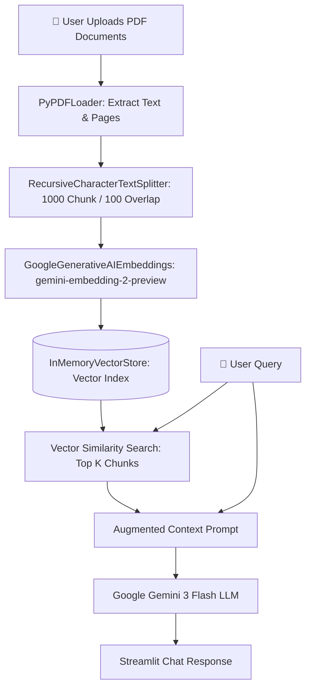

# 📚 AI Multi-PDF RAG Reader Bot

[](https://www.python.org/)
[](https://streamlit.io/)
[](https://www.langchain.com/)
[](https://ai.google.dev/)
[](https://opensource.org/licenses/MIT)

An intelligent, conversational **Retrieval-Augmented Generation (RAG)** application built with **LangChain**, **Google Gemini**, and **Streamlit**. Upload multiple PDF documents, ask complex questions, and receive grounded, accurate answers backed by direct document context.

---

## 🌟 Key Features

- **📑 Multi-Document Upload**: Upload and process multiple PDF files simultaneously.
- **⚡ In-Memory Vector Store**: Fast semantic chunk indexing using `InMemoryVectorStore` without heavy external database dependencies.
- **🧠 Google Gemini 3 Powered**:
  - **Embeddings**: `gemini-embedding-2-preview` for high-dimensional semantic vector representations.
  - **LLM Reasoning**: `gemini-3-flash-preview` for real-time question answering with cited context.
- **💬 Interactive Chat Interface**: Modern, intuitive Streamlit chat UI maintaining full conversational message history.
- **🔄 Session State Controls**: Easily reset your chat and upload new document batches with the sidebar controls.
- **🛡️ Secure Secrets Management**: Fully decoupled API keys using environment variables and template configurations.

---

## 🏗️ Architecture & Workflow



---

## 📁 Project Structure

```text
Document-QnA-Bot/
├── app.py              # Main Streamlit application & RAG pipeline
├── requirement.txt     # Python dependencies
├── .env.example        # Environment variable template
├── .gitignore          # Excludes secrets, virtual environments, and temp files
└── README.md           # Documentation & setup guide
```

---

## 🚀 Getting Started

### 1. Prerequisites
- **Python 3.10+** installed
- A **Google Gemini API Key** from [Google AI Studio](https://aistudio.google.com/app/apikey)

### 2. Clone the Repository
```bash
git clone https://github.com/rakeshjha-code/AI_RAG_PDF_reader_BOT.git
cd AI_RAG_PDF_reader_BOT
```

### 3. Create & Activate a Virtual Environment
```bash
# Windows
python -m venv env
.\env\Scripts\activate

# macOS / Linux
python3 -m venv env
source env/bin/activate
```

### 4. Install Dependencies
```bash
pip install -r requirement.txt
```

### 5. Configure API Key
Copy the template configuration file:
```bash
cp .env.example .env
```
Open `.env` and insert your Gemini API key:
```env
GOOGLE_API_KEY="AIzaSyYourActualKeyHere..."
```

---

## 🖥️ Running the Application

Launch the Streamlit web dashboard:
```bash
streamlit run app.py
```

The app will open automatically in your browser at `http://localhost:8501`.

---

## 💡 How to Use

1. **Upload Documents**: Drag and drop one or more `.pdf` documents into the file uploader.
2. **Process**: Click the **"Process Documents"** button. The app splits text into semantic chunks and creates vector embeddings.
3. **Ask Anything**: Type your questions in the chat input at the bottom.
4. **Reset**: Use the **"Upload New Documents / Reset"** button in the sidebar to start a new session anytime.

---

## 🛠️ Tech Stack

| Component | Technology | Description |
|---|---|---|
| **Frontend** | Streamlit | Responsive, real-time web application |
| **Orchestration** | LangChain | Document loading, chunking, and pipeline orchestration |
| **Embeddings** | `gemini-embedding-2-preview` | Google's multimodal high-density text embeddings |
| **Vector Store** | `InMemoryVectorStore` | Lightweight in-memory semantic search |
| **Large Language Model** | `gemini-3-flash-preview` | Low-latency, high-accuracy conversational reasoning |

---

## 📄 License

This project is licensed under the [MIT License](LICENSE).
